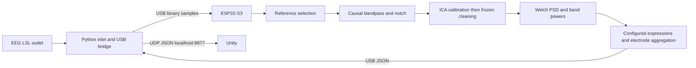

# Unity ESP32 EEG coprocessor

This folder contains standalone firmware for the **Adafruit MatrixPortal ESP32-S3**, a JSON configuration compiler, a Python LSL-to-USB bridge, and a Unity UDP receiver. All filtering, ICA training/cleaning, Welch PSD, and feature arithmetic run on the ESP32. The host resolves LSL, maps labels, converts units, transfers samples, and forwards results.



LSL is a host networking and timestamp layer; plugging the board into USB does not expose LSL to the microcontroller automatically. The bridge is required. The design follows [LSL stream inlet semantics](https://labstreaminglayer.readthedocs.io/projects/liblsl/ref/inlet.html) and [ESP32 USB CDC support](https://docs.espressif.com/projects/arduino-esp32/en/latest/tutorials/cdc_dfu_flash.html).

## Start today

Run these commands from `unity-coprocessor/`. Use Python 3.10+ and a USB data cable. Substitute your actual serial port (`/dev/ttyACM0`, `/dev/cu.usbmodem…`, or `COM5`). Close other serial monitors before starting the bridge.

```bash
python3 -m venv .venv
source .venv/bin/activate
python -m pip install -r requirements.txt

# Generates coefficients/config, builds, packages, and uploads the default firmware.
python tools/build.py --config config/eeg19-existing.json --upload-port /dev/ttyACM0

# Start your existing EEG LSL publisher, then run:
python host/bridge.py --config config/eeg19-existing.json --serial-port /dev/ttyACM0
```

The default LSL name is `ReplayEEG`. It must match your actual publisher. Start a synthetic publisher in another terminal if you want to check transport before using EEG:

```bash
python host/synthetic_lsl.py --config config/eeg19-existing.json
```

For the saved real recording, the existing publisher can also be used from the workspace root:

```bash
python Esp32ComputeModule/phase26_lsl_minimal/lsl_replay_driver.py \
  --easy Esp32ComputeModule/phase37_online_pipeline/results/patient01_seg.easy
```

The prebuilt images are in `artifacts/`. To upload them without compiling, from this folder:

```bash
python tools/flash.py --port /dev/ttyACM0 --dry-run
python tools/flash.py --port /dev/ttyACM0
python host/bridge.py --config artifacts/config.json --serial-port /dev/ttyACM0
```

`manifest.json` records image offsets and SHA-256 checksums. The flash helper verifies those checksums and writes the board-specific bootloader, partition table, boot selection, application, and TinyUF2 images. `firmware.bin` is the application at **0x10000**; it is not a merged image to flash at zero. The included offsets come from the actual PlatformIO build. If uploading fails, use the board's ROM bootloader procedure (hold BOOT, tap RESET, release BOOT), select the newly enumerated port, then reset after flashing. See [Adafruit's board guide](https://learn.adafruit.com/adafruit-matrixportal-s3?view=all).

## Declare a montage and features

Configuration is **compiled into the firmware**. After changing JSON, run `tools/build.py` again and flash. There is no runtime JSON upload or persistence yet. The bridge must use the same complete config; the USB handshake rejects a different SHA-256 config ID. `tools/configure.py CONFIG` generates `firmware/include/generated_config.h` and its JSON snapshot without building.

| File | Input | Reference | Purpose |
|---|---|---|---|
| `config/eeg19-existing.json` | 19 EEG, 500 Hz, volts, `ReplayEEG` | As acquired | Default matching the previous LSL replay module |
| `config/eeg20.json` | 20 electrodes, 500 Hz, microvolts, `EEG` | Subtract included A2 channel | Illustrative layout; A2 is not inferred from the old data |
| `config/eeg32.json` | 32 electrodes, 500 Hz, microvolts, `EEG` | Common average of all listed channels | Illustrative layout, engagement emitted per electrode |

The old replay code uses the montage `P7 P4 Cz Pz P3 P8 O1 O2 T8 F8 C4 F4 Fp2 Fz C3 F3 Fp1 T7 F7`. It reads 19 EEG columns and explicitly identifies column 20 as **EXT**, not another EEG electrode or a reference. The `.easy` values are nanovolts; the old replay publisher converts them to volts. The default bridge converts those volts to microvolts. The physical acquisition reference cannot be recovered from this channel list, so the default preserves the acquired reference. Do not invent or subtract an unrecorded reference channel.

The configured `channels` list defines the firmware channel order and count. The bridge maps incoming LSL labels case insensitively, tolerates extra labeled channels such as EXT, and rejects missing/duplicate labels, incorrect sample rate, and conflicting unit metadata. No channels are selected by blindly taking the first N. `allow_missing_labels: true` explicitly enables positional input only when the entire stream shape equals the config. Missing unit metadata uses the configured `input_unit` and logs that assumption.

Example feature rows:

```json
"ratios": [
  {
    "name": "attention",
    "expression": "beta / theta",
    "channels": ["Fp1", "Fp2"],
    "aggregate": "mean"
  },
  {
    "name": "engagement",
    "expression": "beta / (alpha + theta)",
    "channels": ["Cz", "C4", "C3"]
  }
]
```

Expressions support configured band names, finite numeric constants, `+`, `-`, `*`, `/`, parentheses, and unary minus. Function calls, executable code, powers, and unknown names are rejected. Band names are case sensitive; `tetha` is rejected if the declared band is `theta`. An expression can also be a band name alone (`"alpha"`) to emit its power. Ratios are illustrative spectral features; their names do not establish validated attention or engagement measurements.

`aggregate: "mean"` computes the expression **separately for each electrode, then takes the arithmetic mean**. It does not average EEG first or divide averaged band powers. Omit `aggregate` (or use `"none"`) for one output per electrode. An invalid member makes the entire mean invalid; members are not silently dropped.

Reference modes are `as_acquired`, `channel` with a recorded channel name, and `average` over all configured channels. In channel mode, the included reference is subtracted from every channel and cannot be a feature electrode. Auxiliary/non-EEG channels must be excluded from `channels`, especially for average reference. To use an acquisition reference that is not independently recorded, select `as_acquired`.

## DSP behavior and limits

- Sampling rate is a declared property (`sample_rate_hz`, 128–2000 Hz). This is a supported config range, not a measured real-time capacity. The bridge rejects an LSL rate mismatch rather than resampling.
- Filtering uses a causal Butterworth bandpass in second-order sections, plus an optional notch. `order: 4` is the Butterworth prototype order (an eighth-order bandpass). `notch_hz: null` disables the notch. Streaming filtering has phase delay; it does not use `filtfilt`.
- Default bands are theta `[4,8)`, alpha `[8,13)`, and beta `[13,30)` Hz. Each band power sums one-sided PSD bins in a half-open interval and multiplies by frequency spacing. Units are µV². Shared boundaries are not counted twice.
- Welch uses a periodic Hann, segment-wise constant detrending, density normalization, and arithmetic averaging of overlapping periodograms, following [SciPy Welch](https://docs.scipy.org/doc/scipy/reference/generated/scipy.signal.welch.html). `window_seconds` is the total history; `segment_samples` controls frequency resolution; `overlap_samples` controls overlap within that history; `hop_seconds` controls output spacing. At 500 Hz, the default 512-sample segment gives approximately 0.977 Hz bins. A 4-second history contains six complete segments with 256-sample overlap; the unused trailing 208 samples follow SciPy's complete-segment convention. Output timestamps mark the history's newest sample; the last included segment ends 208 samples earlier. Choose compatible history/segment lengths if that offset matters.
- Durations must resolve to whole samples. FFT length is a power of two, 32–4096; history is at most 8192 samples; configurations support 2–32 electrodes, 1–16 bands, and 1–16 expressions. These are allocation/validation limits, not throughput guarantees. Increasing electrodes, windows, or output count increases memory and compute cost.
- The history allocation prefers the board's PSRAM and falls back to internal RAM. Allocation failure stops the pipeline. Compiler-reported static RAM excludes the heap-allocated engine and history.
- The default quality gate marks a history invalid if any pre-cleaning, filtered electrode exceeds 150 µV in absolute magnitude. Division by a denominator below `min_denominator_uv2` emits `null` and `valid: false`; overflow/nonfinite arithmetic does likewise. The threshold applies to each division, so use care with formulas whose denominator has different physical units. Quality flags are basic amplitude checks, not a complete EEG quality assessment.

## ICA policy

The default is `calibrate_then_freeze`, adapted from the repository's Phase 37 fixed-whitening/tanh natural-gradient approach. After 2 seconds of filter settling it estimates covariance for 10 seconds, computes descending PCA whitening with a relative rank cutoff, trains an orthogonal ICA rotation on 16-sample blocks for at least 20 seconds, then freezes the transform and artifact selection. It does not estimate a new ICA model for every Welch window. All complete histories use one frozen transform. At 500 Hz the 10,000-sample training duration spans exactly 625 blocks, so the first result appears after approximately **36 seconds** of continuous input; later results arrive every 0.5 seconds. Other training durations round up to a complete 16-sample block. Status messages identify settling, calibration, training, and Welch warmup.

Rank is reduced for common-average and channel reference instead of whitening a zero dimension. Very low-rank/flat calibration or numerical failure stops processing and asks for a restart. Filtering before ICA and rank handling follow the concerns described in [MNE's ICA documentation](https://mne.tools/stable/generated/mne.preprocessing.ICA.html).

Artifact selection is explicit:

- `removal: "frontal_projection"` selects **at most one** component whose absolute mixing weights on `frontal_channels` exceed `frontal_fraction_threshold` of its total absolute weights. If none qualifies, no component is removed. The default threshold is 0.35. This is an **experimental spatial heuristic inherited from the earlier work**, not verified blink identification. Frontal brain activity can be removed too. Review the reported component selection and compare results before interpreting features.
- `removal: "components"` uses the zero-based `remove_components` list. ICA component order is specific to each calibration and is not a stable anatomical label; inspecting a previous session does not identify components in a new session.
- `removal: "none"` still calibrates and trains ICA but removes no components. This preserves the filtered EEG and is useful for comparisons.
- `mode: "disabled"` explicitly bypasses ICA for diagnostics and PSD comparisons.

Cleaning subtracts selected component projections in electrode space, preserving unremoved activity, the mean, and discarded low-variance residual dimensions. Keep the calibration representative of the session, including eye artifacts when you intend to learn their spatial pattern. There is no convergence guarantee or automatic validated component classifier. Restart the bridge to recalibrate when the cap/reference changes or the frozen model becomes unsuitable. The default ICA coefficients are learned in RAM after startup, not saved across power cycles.

## USB and Unity contract

The binary input protocol is little endian: `"UC"` (2 bytes), type (1), version=1 (1), payload length (uint16), sequence (uint32), payload, CRC32 (uint32 over header and payload, IEEE/zlib convention). HELLO type 2 carries the 64 ASCII config-hash characters. DATA type 1 carries uint16 channel count, uint16 sample count, then 1–32 records of float64 LSL timestamp followed by N float32 microvolt values.

Device output is newline-delimited JSON. One batch is outstanding at a time; the host waits for its ACK before sending more. Partial USB reads are assembled. Corrupt packets, wrong shapes, duplicate/missing sequences, nonfinite values, and incompatible configurations stop streaming instead of generating plausible-looking results. The host reports errors on stderr and exits; restart it to handshake and reset. A sample timestamp gap above 2.5 nominal periods restarts the DSP calibration and clears the history. Nonmonotonic timestamps are rejected. Timestamps remain in the source LSL clock domain; there is no silent clock conversion or interpolation. The host uses LSL time correction only for its backlog check and stops if that backlog exceeds one second.

Example feature message (values are illustrative):

```json
{
  "type": "features",
  "config_id": "the-64-character-config-hash",
  "lsl_time": 12345.0,
  "window_start": 12341.002,
  "samples": 18016,
  "discontinuities": 0,
  "valid": true,
  "ica_rank": 19,
  "removed_components": [0],
  "compute_us": 4200,
  "values": [
    {"name": "attention", "channel": "mean", "valid": true, "value": 1.2},
    {"name": "engagement", "channel": "Cz", "valid": true, "value": 0.8}
  ]
}
```

`compute_us` covers the last sample processing and feature estimation, excluding JSON serialization/USB output; ACK `batch_compute_us` includes the batch and its synchronous JSON writes. Neither is an independently measured end-to-end latency. The startup `configuration` datagram includes the complete config, so consumers can recover which electrodes a mean represents. A feature message's top-level `valid` is the amplitude gate; each value also has its own arithmetic-valid flag. Consumers must check both.

Copy `unity/EegCoprocessorReceiver.cs` into Unity's Assets folder and attach it to a GameObject. It listens on localhost port 9877, transfers work to Unity's main thread, and exposes `OnFeatures`, `latest`, and `HasFreshFeatures`. It suppresses callbacks for invalid results, bounds its queue, and clears stale feature availability after `maxAgeSeconds` (default 2). Set that timeout above your configured output interval. Keep Unity and the bridge on the same machine for this receiver; its listener intentionally binds to loopback. UDP delivery is not acknowledged.

## Validation

```bash
python tests/test_system.py
python tests/lsl_smoke.py
```

The numerical tests compile the same C++ DSP with `g++` and undefined-behavior instrumentation, compare filter/Welch results with SciPy, check 19/20/32-channel ICA rank and warmup, test synthetic frontal-source attenuation, quality gating and expression rejection, and run the actual firmware entry points through a Linux serial/allocator adapter to check handshake, features, CRC, sequence, and gap recovery. The LSL smoke test publishes and receives a real local LSL stream and exercises label/unit mapping and packet generation. These checks do not measure ESP32 runtime or prove physiological validity. See `VALIDATION.md` for results from this build.

## Earlier code reviewed

- `../Esp32ComputeModule/firmware/EsP32EegInference_StreamOnline/` — causal filtering, USB ingestion, fixed-whitening ICA and frontal projection.
- `../Esp32ComputeModule/phase37_online_pipeline/p37_orica_host.py` — the 19-electrode montage and host ICA experiment.
- `../Esp32ComputeModule/phase26_lsl_minimal/lsl_replay_driver.py` — 500 Hz, EEG versus EXT, channel labels, and unit conversion.
- `../paper/IEEEVR2027-short/ESP32_IMPLEMENTATION_AUDIT.md` — earlier implementation limitations.

The new code has no dependency on the old experimental classifiers or model-weight headers.
